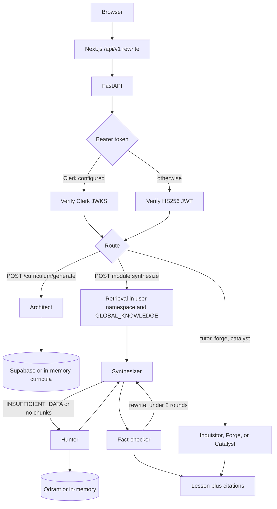

# Fidya

[](https://github.com/fauzulazkiaa/Fidya-Ai/actions/workflows/ci.yml)

Fidya is an AI education app: a Next.js frontend and a FastAPI backend that builds a syllabus, retrieves source chunks, and drafts a lesson with citations. The backend agents run on LangGraph. With no API keys they use an in-process mock LLM, hash embeddings, and in-memory stores.

A longer product spec lives in [`prd-fidya-education-platform.md`](prd-fidya-education-platform.md). This README describes what the code does today.

## Architecture

The browser talks to Next.js. `web/next.config.ts` rewrites `/api/v1/*` to the FastAPI process (`BACKEND_URL`, default `http://127.0.0.1:8000`). Product pages call that API through `web/src/hooks/use-api.ts`.

Auth on the API (`backend/app/api/deps.py`):

- If `CLERK_PUBLISHABLE_KEY` or `CLERK_JWKS_URL` is set, a Clerk session JWT is verified against Clerk's JWKS.
- Otherwise a local HS256 JWT from `/api/v1/auth/register` and `/login` is accepted. The default secret is rejected when `DEBUG` is false and Clerk is not configured.



`backend/app/agents/supervisor.py` also compiles a LangGraph with the same nodes. The generate route calls `architect_node` directly. The synthesize route calls retrieval, the synthesizer, the hunter, and the fact-checker itself. The SSE route (`GET .../stream`) walks nodes in `run_graph_stream` and does not invoke the compiled graph.

### Agents in `backend/app/agents`

| File | What it does |
| --- | --- |
| `architect.py` | Turns the onboarding payload into a week-by-week syllabus with objectives and search keywords. |
| `supervisor.py` (`hunter_node`) | Fetches public sources for those keywords, chunks them, embeds them, and upserts the `GLOBAL_KNOWLEDGE` namespace. The HTTP client is `backend/app/services/hunter.py` (arXiv, OpenAlex, DOAJ, Europe PMC, Wikipedia, Semantic Scholar). |
| `synthesizer.py` | Writes a markdown lesson that must cite `[chunk_id]`, or returns exactly `INSUFFICIENT_DATA` when there are no chunks. |
| `fact_checker.py` | Splits the draft into sentences and drops factual sentences whose `[chunk_id]` is unknown or whose words do not overlap the chunk. |
| `inquisitor.py` | Returns one Socratic question or hint and a mastery score from 1 to 5. The prompt forbids giving the answer. |
| `forge_agent.py` | Reviews the text in `active_goal` and returns a summary, vulnerabilities, suggested diffs, and rubric scores. |
| `catalyst.py` | Returns one cross-domain analogy card for the current module. |
| `state.py` | `SyntaxState`, the typed dict the nodes read and update. |
| `supervisor.py` | Maps `intent` to a node and compiles the graph. After the fact-checker it stops on `passed` or after two rewrites. |

When `GOOGLE_API_KEY` is empty, `get_llm()` returns `MockLLM` (`backend/app/services/llm.py`), which fills the Pydantic schema with deterministic placeholder fields. Embeddings then come from token hashes (768 dimensions).

## Tech stack

- **Web:** Next.js 16, React 19, Tailwind CSS 4, Clerk (`@clerk/nextjs`). `web/prisma/schema.prisma` is in the repo; no file under `web/src` imports Prisma.
- **API:** FastAPI, Pydantic v2, PyJWT (PBKDF2 password hashes in `backend/app/core/security.py`).
- **Agents:** LangGraph and `langchain-core`.
- **Models:** Google Gemini over HTTP when `GOOGLE_API_KEY` is set. Optional Vertex ranking when `VERTEX_RANKING_ENABLED=true`.
- **Data:** Qdrant (`qdrant-client`) and Supabase (`supabase`). Both have in-memory fallbacks.
- **Tests:** pytest and pytest-asyncio.

## Local setup

Python 3.11 and Node.js 20+ (CI uses Node 22).

### Backend

```bash
cd backend
python3 -m venv .venv && source .venv/bin/activate
pip install -r requirements.txt
cp .env.example .env
uvicorn app.main:app --reload --port 8000
```

Interactive docs are at http://localhost:8000/docs while `DEBUG=true` (the default).

Leave `GOOGLE_API_KEY`, `QDRANT_URL`, and `SUPABASE_URL` empty to stay offline:

| Missing setting | Fallback in code |
| --- | --- |
| `GOOGLE_API_KEY` | `MockLLM` and hash embeddings |
| `QDRANT_URL` | `QdrantClient(":memory:")` |
| `SUPABASE_URL` or server key | in-memory tables in `backend/app/db/supabase_client.py` |
| `SMTP_HOST` | re-engagement email is logged and not sent |
| `VERTEX_RANKING_ENABLED` | lexical-overlap reranker |

Those stores are wiped when the process exits. The Hunter still calls public HTTP APIs when a module is synthesized. The pytest suite does not call the Hunter.

To use real services, fill the matching keys in `.env` and run `schema.sql` in the Supabase SQL editor. Later SQL is in `backend/migrations/`.

### Web

```bash
cd web
cp .env.example .env.local
npm ci
npm run dev
```

Open http://localhost:3000. With `NEXT_PUBLIC_CLERK_PUBLISHABLE_KEY` empty, `web/src/middleware.ts` does not protect routes. The root layout still mounts `ClerkProvider`. Set `BACKEND_URL` if the API is not on `http://127.0.0.1:8000`.

## Tests

From a clean checkout, with no API keys:

```bash
cd backend
pip install -r requirements.txt
pytest
```

The suite covers chunk ids, citation parsing, fact-checker guardrails, Qdrant namespace isolation, and register → login → curriculum generation → module complete → analytics over HTTP. Curriculum generation uses `MockLLM`.

CI (`.github/workflows/ci.yml`) runs that pytest job on Python 3.11, and `npm ci && npm run lint` in `web/`, on every push and pull request.

## Project structure

```
.
├── backend/
│   ├── app/          # agents, api, core, db, models, services
│   ├── migrations/
│   └── tests/
├── web/
│   ├── content/
│   ├── prisma/       # schema only
│   ├── public/
│   ├── scripts/      # SEO helpers; not on the request path
│   └── src/          # app, components, hooks, lib
├── prd-fidya-education-platform.md
├── LICENSE
└── README.md
```

## What I'd improve next

1. **One graph execution path.** `build_graph()` defines the edges, but syllabus generation, module synthesis, and the SSE handler each call nodes on their own. A routing change has to be repeated in those three places.
2. **Offline Hunter fixtures.** Synthesis depends on live arXiv, OpenAlex, DOAJ, Europe PMC, Wikipedia, and Semantic Scholar calls. The current tests never exercise that path.
3. **Durable local state and a longer JWT secret.** The default `JWT_SECRET` is `dev-secret-change-me` (20 bytes; PyJWT warns that SHA-256 HMAC keys should be at least 32). The in-memory Supabase and Qdrant fallbacks also disappear on restart. `web/prisma` is unused and is easy to mistake for the real database.
