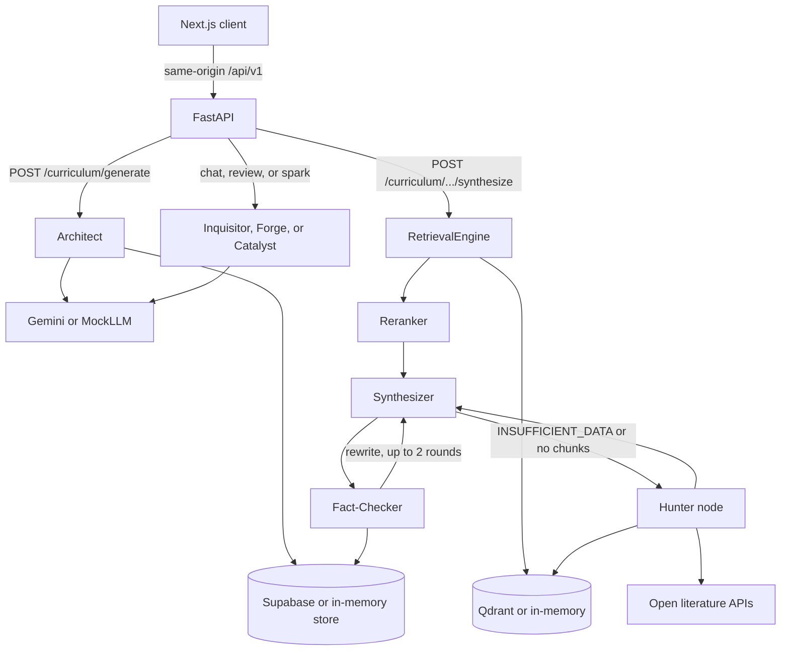

# Fidya

[](https://github.com/fauzulazkiaa/Fidya-Ai/actions/workflows/ci.yml)

Fidya is an AI education platform. A learner describes a topic, level, deadline, and weekly hours. The backend builds a module plan, retrieves source text, and drafts lessons that cite those sources. A separate checker removes citations that do not match a retrieved chunk and drops some uncited factual sentences. Other agents handle Socratic questions, submission review, and a single analogy card.

This repository is the Next.js UI (`web/`) and the FastAPI + LangGraph backend (`backend/`). A longer product spec lives in `prd-fidya-education-platform.md`. The notes below describe the code that is here, not every item in that spec.

## Architecture

The browser talks to the Next.js app. `web/next.config.ts` proxies `/api/v1/*` to the FastAPI process (`BACKEND_URL`, default `http://127.0.0.1:8000`). FastAPI routes in `backend/app/api/routes/` authenticate the caller, then call a LangGraph node or a small pipeline around those nodes. Shared agent state is the `SyntaxState` dict in `backend/app/agents/state.py`.

Agents in `backend/app/agents`:

| Agent | File | What the code does |
| --- | --- | --- |
| Architect | `architect.py` | Builds a week-by-week syllabus (modules, objectives, search keywords, milestones) from the onboarding payload. |
| Supervisor | `supervisor.py` | Routes intent to a node and runs the Hunter → Synthesizer → Fact-Checker loop, including SSE events. The Hunter node lives in this file. |
| Synthesizer | `synthesizer.py` | Writes a markdown lesson that must cite retrieved chunk ids, or returns `INSUFFICIENT_DATA`. |
| Fact-Checker | `fact_checker.py` | Drops dangling chunk ids and uncited factual sentences using lexical token overlap. |
| Inquisitor | `inquisitor.py` | Returns one Socratic reply plus a mastery score from 1 to 5. The prompt tells the model not to give the answer. |
| Forge | `forge_agent.py` | Reviews the text in `active_goal` and returns strengths, vulnerabilities, suggested rewrites, and rubric scores. |
| Catalyst | `catalyst.py` | Returns one cross-domain analogy card. |

`state.py` is the shared state schema, not an agent. Source fetching itself is `backend/app/services/hunter.py` (arXiv, OpenAlex, DOAJ, Europe PMC, Wikipedia, Semantic Scholar). Embeddings, Qdrant, and the in-memory stores are under `backend/app/services/` and `backend/app/db/`.



`GET /api/v1/curriculum/{id}/modules/{module_id}/stream` and `GET /api/v1/agent/stream` emit the same agent steps as server-sent events. Both require the `Authorization` header.

## Tech stack

- **Web:** Next.js 16, React 19, TypeScript, Tailwind CSS 4, Clerk (optional). ESLint is configured.
- **API:** Python 3.11, FastAPI, Pydantic, LangGraph, PyJWT (PBKDF2 passwords and HS256 tokens).
- **Models and retrieval:** Google Gemini via `google-generativeai` when `GOOGLE_API_KEY` is set; Qdrant for vectors; a lexical overlap reranker when Vertex ranking is off.
- **Persistence:** Supabase when URL and server key are set. Otherwise an in-memory table emulator.
- `web/prisma/schema.prisma` declares a Postgres datasource. Nothing under `web/src` imports Prisma.

## Local setup

### Backend

```bash
cd backend
python3 -m venv .venv && source .venv/bin/activate
pip install -r requirements.txt
cp .env.example .env
uvicorn app.main:app --reload --port 8000
```

Interactive docs: http://localhost:8000/docs (only while `DEBUG=true`, which is the default).

Leave the secret fields in `.env` empty to stay offline:

| Variable unset | What runs instead |
| --- | --- |
| `GOOGLE_API_KEY` | `MockLLM` for structured and text generation, and 768-d hash embeddings |
| `QDRANT_URL` | Qdrant local mode (`:memory:`) |
| `SUPABASE_URL` or the server key | In-memory tables in `supabase_client.py` |
| `SMTP_HOST` | Re-engagement and newsletter mail are logged, not sent |

The in-memory database and vector store reset when the process exits. For a real database, create a Supabase project, run `backend/schema.sql` (then the files in `backend/migrations/`), and set `SUPABASE_URL` plus `SUPABASE_SECRET_KEY` (legacy `SUPABASE_SERVICE_KEY` is still accepted). Qdrant Cloud needs `QDRANT_URL` and `QDRANT_API_KEY`. Gemini needs `GOOGLE_API_KEY`.

`JWT_SECRET` in `.env.example` is a placeholder. The code default is a short development value and is rejected when `DEBUG` is false and Clerk is not configured.

### Web

```bash
cd web
cp .env.example .env.local
npm ci
npm run dev
```

Open http://localhost:3000. With `NEXT_PUBLIC_CLERK_PUBLISHABLE_KEY` empty, `src/middleware.ts` does not protect routes and `useFidyaAuth()` returns a local mock user. Set that key and `CLERK_SECRET_KEY` to use Clerk. `CLERK_SECRET_KEY` is read by the Clerk SDK, not by application code.

`npm run dev` proxies API calls to the backend started above.

## Tests

From a clean checkout, with no API keys:

```bash
cd backend
pip install -r requirements.txt
pytest
```

The suite covers chunk ids, citation parsing, fact-checker pruning, Qdrant namespace filters, and the register → curriculum generate → complete → progress HTTP flow against `MockLLM` and the in-memory stores. It does not call Gemini, Qdrant Cloud, or Supabase.

CI runs that pytest job on Python 3.11, and `npm ci && npm run lint` in `web/`, on every push and pull request.

## Project structure

```
.
├── backend/
│   ├── app/            # FastAPI app, LangGraph agents, retrieval services
│   ├── migrations/     # SQL applied after schema.sql
│   └── tests/          # pytest
├── web/
│   ├── content/        # SEO copy JSON
│   ├── prisma/         # schema only; unused by web/src
│   ├── public/         # static assets
│   ├── scripts/        # SEO helper scripts, not part of the app runtime
│   └── src/            # Next.js App Router UI
├── prd-fidya-education-platform.md
├── LICENSE
└── README.md
```

## What I'd improve next

1. **Entailment, not token overlap.** `fact_checker.py` keeps a cited sentence when about 12% of its words appear in the chunk. A paraphrase of a real source can be deleted, and a short overlapping phrase can pass. Use a real entailment check when Gemini is configured, and keep this scorer for offline runs.
2. **Offline fixtures for the Hunter.** `hunter.py` calls live public APIs, and no test drives that path. Record those HTTP responses so the synthesize pipeline can run in CI without the network.
3. **Finish the loose ends reviewers will trip on.** ESLint still warns in `web/src/app/onboarding/page.tsx` (missing `useEffect` dependency) and `web/src/middleware.ts` (unused `_req`). `web/prisma/schema.prisma` is unused. The development JWT secret is shorter than PyJWT's recommended HMAC length, which the test run warns about.
